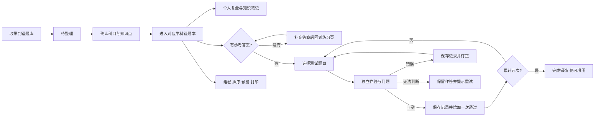

# 打铁匠产品逻辑设计

更新日期：2026-11-05。此文为当前生效的产品规则，优先于较早的五种能力任务方案。

## 产品主线

打铁匠以“错题库 → 学科错题本 → 知识点”三层结构组织学习：先收录所有题目，再按科目进入对应错题本，在科目内部标记一个主知识点和少量相关知识点，最后记录错因、理解并通过独立测试积累锻造进度。组卷是把选定错题编排成纸质试卷的独立工具。

## 页面职责

| 页面 | 主要操作 | 完成后的去向 |
| --- | --- | --- |
| 首页 | 快速收录、处理待整理、查看最近收录、轻量练习提醒 | 错题页或练习页 |
| 错题库 | 跨学科收录、待整理、搜索、批量管理和回收 | 进入对应学科错题本或原题页 |
| 我的错题本 | 按科目进入，按知识点筛选、整理、复盘和查看历史 | 原页继续工作，或去练习选题 |
| 收录 | 保存文字、图片和当时的作答，允许稍后整理 | 首页显示收录回执，继续整理可直接打开编辑器 |
| 组卷 | 选择已整理错题、排序、保存试卷、A4 预览与打印 | 试卷详情；不启动在线测试 |
| 练习 | 今日到期、自主选题、独立测试、查看结果、设置提醒 | 回到原练习页，保留当前筛选 |
| 知识笔记 | 汇总理解、关联相关错题 | 阅读笔记或练习关联题 |
| 成长记录 | 展示活动、当前有效测试通过率和锻造完成情况 | 可进入需要巩固的题目 |

底部固定：首页、错题本、收录、组卷、练习。错题本页面顶部可切换“我的错题本”和“错题库”；旧版本子作为低干扰兼容入口保留。其他工具从左上角菜单进入。默认进入首页。书架“去练习”进入选题页，单题详情可直接测试该题。所有入口每轮最多十道，避免无意开启全部题目。

## 错题本与学科

主书架按 `subject` 聚合为“数学错题本”“英语错题本”等科目空间；同一题只能有一个主知识点，也可以有少量相关知识点。旧版自定义本子的 `notebookId`、封面和归属仍保存在数据与备份中，可从“旧版本子”入口访问，避免旧档案丢失，但不再作为新题目的主要分类方式。

旧标签仍保留用于兼容和全文搜索，新的整理流程不再要求维护几十个标签。科目内知识点优先使用对应学科的知识点目录，也允许补充自定义知识点；未判断的题目进入“待归类”。

## 三个独立维度

1. **整理状态**：待整理／已整理。允许已整理题目暂缺参考答案，仍可记复盘、组卷与打印。
2. **测试资格**：题目未删除、已整理且有参考答案。待整理和缺答案各有明确处理入口，不能混入测试队列。
3. **锻造进度**：当前题目版本累计的有效测试通过次数，上限五次。手动状态标记、自评和排期都不能代替通过记录。

界面称为“五阶完成”，避免把练习成就误当成永久理解程度。错因、心得和知识笔记是学生自己的记录，不是系统生成的理解评分。

## 测试与判题

- 先按今日到期或自主选题选择题目，可按科目、关键词和进度筛选，最多十道一轮。
- 提交期间固定题目内容与本次作答。题干、答案、原题图片发生变化，旧结果不得提交；用户可以重新载入后测试。
- 仅能可靠核对的选项或数值使用本地判题。明确要求步骤、证明或解释的题目交给 AI；图片题携带原图交给 AI，不能只按参考答案中的数字猜测通过。
- AI 无法判断或服务不可用时保留作答，不记录成功。模型只是辅助判题，反馈展示给使用者核对。
- 每次明确判题通过并保存后增加一阶。允许同日完成，不要求连续正确；错误不扣除已通过次数，心得选填。
- 同一提交标识重复保存只对应一条记录。保存失败留在本题，重试不会重复升级；成功保存后才显示完成画面。
- 当前题目发生实质修改时，旧测试保留为归档历史，不计入新版本进度。仅编辑标题、标签、备注或复盘不重置进度。
- 额外巩固不超过五阶。本轮重练保留之前的测试结果，汇总仍能看到全部尝试。

## 复习提醒与统计

提醒日期只负责安排任务，不决定能否随时测试，也不改变锻造完成状态。测试提交后消耗已到期提醒；未来已设提醒与本次推荐的未来日期取较早者。第五次通过不会抹掉原有未来提醒，不再新增默认提醒。

测试通过率仅统计未删除、已整理题目的当前有效判题记录；旧自评及题目旧版本不计入该通过率。每日活动和历史仍保留真实发生的旧练习。完成数以有效五次通过派生，加载、导入、编辑和重置示例遵循同一规则。

## 试卷引用与打印

试卷保存的是有序选题引用，打印使用这些题目的当前内容。若题目改科后不再满足原单科试卷，受影响试卷自动改为综合，保证数据仍能完整备份与恢复。

删除或暂未整理的原有题目引用可以保留，预览明确提示不可用数量；仅改卷名或顺序不会悄悄清除这些引用，恢复题目后可以重现。新选题必须可用。切换试卷学科若会移除已选题，先明确提示并让使用者选择。

打印不包含原作答、复盘和学习状态。缺答案题仍保留原题，在可选的卷末答案页标记待补充。浏览器提供 A4 打印，微信端导出 Word 后处理打印。

## 验证入口

- `npm run verify:notebooks`：空本、封面、归属、旧数据迁移与备份兼容。

- `npm run verify:forge`：次数、版本、提醒、统计、试卷引用、导入等域规则。
- `npm run verify:assessment`：精确判题、步骤要求、AI 协议与原图传递。
- `.validation/logic-workflow-qa.cjs`：补答案返回、选题批量限制、测试队列、旧题保护与手机布局。
- `.validation/print-paper-qa.cjs`：试卷预览、答案附录、留白、隐私内容排除与打印调用。
